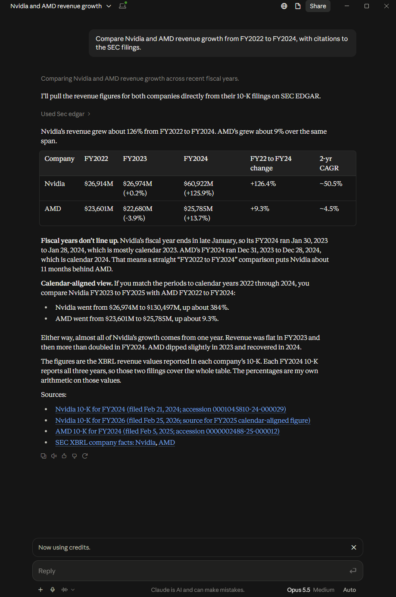
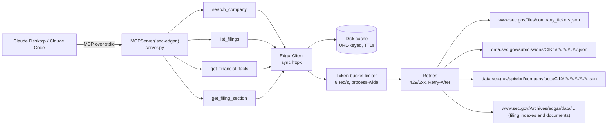

# sec-edgar-mcp

[](https://github.com/mwaseemUC/sec-edgar-mcp/actions/workflows/ci.yml)
[](LICENSE)

An MCP server that gives Claude typed tools over SEC EDGAR: company lookup, filing lists, annual XBRL
financial facts, and 10-K/10-Q item sections. It can answer questions like "compare Nvidia's and AMD's
revenue growth over three years" and cite the filings each number came from.

**Eval:** with `claude-sonnet-5-5`, 10/10 golden questions were grounded correct. That means each value was
correct, appeared in that question's own tool outputs, and came from the expected tools. All 10 answers cited
a tool-returned SEC URL. The run cost $0.17 in total (2026-10-16).

<!-- TODO: add a screenshot of Claude Desktop answering a question with this server at docs/claude-desktop-demo.png -->


Four read-only tools, every result carries a `source_url`, polite to SEC by construction (User-Agent,
8 req/s limiter, Retry-After, disk cache). Built on the official MCP Python SDK v2 (`MCPServer`, formerly
FastMCP). Python 3.12, MIT.

---

## Contents

- [Eval results](#eval-results)
- [Tools](#tools)
- [Setup](#setup)
- [SEC fair access](#sec-fair-access)
- [How it works](#how-it-works)
- [Evals](#evals)
- [Technical decisions](#technical-decisions)
- [Limitations and what didn't work](#limitations-and-what-didnt-work)
- [Development](#development)

## Eval results

Claude answered all 10 golden questions through the real stdio MCP server against live SEC data. The scorer
then checked each answer against values taken from SEC JSON.

- **Run:** 2026-10-16T00:18:17Z
- **Model:** requested `claude-sonnet-5-5`; served `claude-sonnet-5-5`. Adaptive thinking and effort were
  left at their defaults, with at most 8 tool turns per question.
- **Source:** [`evals/results/results.md`](evals/results/results.md) and
  [`evals/results/latest.json`](evals/results/latest.json)

| Metric | Value |
|---|---|
| **Grounded correct** | 10/10 (100%) |
| Correct (strict; can be satisfied from memory) | 10/10 (100%) |
| Correct (partial credit) | 100% |
| Cited a tool-returned SEC URL | 100% |
| Used expected tools | 100% |
| Tool calls / question | 2.4 |
| Tokens in / out | 84 / 5,904 |
| Cache write / read tokens | 37,692 / 84,516 |
| Cost | $0.1703 |
| Latency mean / total | 6.6s / 66.5s |

| Q | Label | Expected | Model | OK | Grounded | Cited | Tools | Calls |
|---|---|---|---|---|---|---|---|---|
| q01 | AAPL FY2023 revenue | 383,285,000,000 | 383,285,000,000 | Y | Y | Y | Y | 2 |
| q02 | NVDA FY2024 revenue | 60,922,000,000 | 60,922,000,000 | Y | Y | Y | Y | 5 |
| q02 | AMD FY2024 revenue | 25,785,000,000 | 25,785,000,000 | Y | Y | Y | Y | 5 |
| q02 | NVDA revenue growth FY2022-FY2024 | 126.4 | 126.4 | Y | Y | Y | Y | 5 |
| q02 | AMD revenue growth FY2022-FY2024 | 9.3 | 9.3 | Y | Y | Y | Y | 5 |
| q03 | MSFT FY2024 diluted EPS | 11.8 | 11.8 | Y | Y | Y | Y | 2 |
| q04 | JPM total assets 2023-12-31 | 3,875,393,000,000 | 3,875,393,000,000 | Y | Y | Y | Y | 2 |
| q05 | TSLA FY2023 net income | 14,997,000,000 | 14,997,000,000 | Y | Y | Y | Y | 2 |
| q05 | TSLA FY2024 net income | 7,091,000,000 | 7,091,000,000 | Y | Y | Y | Y | 2 |
| q05 | TSLA net income change FY2023-FY2024 | -52.7 | -52.7 | Y | Y | Y | Y | 2 |
| q06 | GOOGL FY2023 operating income | 84,293,000,000 | 84,293,000,000 | Y | Y | Y | Y | 2 |
| q06 | GOOGL operating income growth FY2022-FY2023 | 12.6 | 12.6 | Y | Y | Y | Y | 2 |
| q07 | MSFT 10-K filed in 2024 accession | 0000950170-24-087843 | 0000950170-24-087843 | Y | Y | Y | Y | 2 |
| q08 | TSLA 10-K/A filed in 2025 accession | 0001104659-25-042659 | 0001104659-25-042659 | Y | Y | Y | Y | 2 |
| q08 | TSLA 10-K/A filed in 2025 filing date | 2025-04-30 | 2025-04-30 | Y | Y | Y | Y | 2 |
| q09 | NVDA FY2024 10-K reportable segments | 2 | 2 | Y | Y | Y | Y | 2 |
| q10 | MSFT employees 2024-06-30 | 228,000 | 228,000 | Y | Y | Y | Y | 3 |

**Dry run (can the tools produce the answers?).** A separate check runs without Claude. It replays a scripted
"oracle" tool plan for each question through the same stdio MCP server against live SEC data, then checks
that every expected value (or, for growth rates, both inputs) appears in the tool output. Result: **10/10
questions reproducible from tool output** ([`evals/results/dry_run.md`](evals/results/dry_run.md)).

**How to read 10/10.** This golden set is saturated for this model. The values are well-known public figures
and every question is single-hop, so "strict correct" could be met from memory. That is why grounded
correctness is the headline: a value only counts if it also appears in that question's own successful tool
outputs. Harder questions are listed under [Limitations](#limitations-and-what-didnt-work).

## Tools

All four tools are read-only (`readOnlyHint`, `idempotentHint`). Each returns a pydantic model as structured
output, and each model has a `source_url` pointing at the exact SEC URL its data came from. Errors (bad CIK,
unknown concept, section not found, missing `SEC_USER_AGENT`) come back as MCP tool errors with a message the
model can act on.

The examples below are real outputs from the eval run, trimmed.

### `search_company`

Find companies by name or ticker and return their 10-digit CIKs. Matches are ranked: exact ticker, exact name,
name prefix, substring, then word overlap.

| Parameter | Type | Default | Notes |
|---|---|---|---|
| `name` | str | required | Company name or ticker, e.g. `nvidia`, `AMD` |
| `limit` | int | 5 | 1-100 |

```json
{
  "query": "Apple",
  "matches": [
    {"cik": "0000320193", "name": "Apple Inc.", "ticker": "AAPL",
     "source_url": "https://www.sec.gov/files/company_tickers.json"},
    {"cik": "0001418121", "name": "Apple Hospitality REIT, Inc.", "ticker": "APLE", "...": "..."}
  ],
  "source_url": "https://www.sec.gov/files/company_tickers.json"
}
```

### `list_filings`

List a company's recent filings, newest first, with accession numbers and URLs. The list covers the
submissions API's recent window, which is about the last 1,000 filings.

| Parameter | Type | Default | Notes |
|---|---|---|---|
| `cik` | str | required | `320193`, `0000320193` or `CIK320193` |
| `form_type` | str \| None | None | Exact, case-insensitive: `10-K` does not include `10-K/A` |
| `limit` | int | 10 | 1-100 |

```json
{
  "cik": "0000789019",
  "company_name": "MICROSOFT CORP",
  "form_type": "10-K",
  "filings": [
    {
      "accession": "0000950170-24-087843",
      "form": "10-K",
      "filing_date": "2024-07-30",
      "report_date": "2024-06-30",
      "primary_document": "msft-20240630.htm",
      "description": "10-K",
      "document_url": "https://www.sec.gov/Archives/edgar/data/789019/000095017024087843/msft-20240630.htm",
      "index_url": "https://www.sec.gov/Archives/edgar/data/789019/000095017024087843/0000950170-24-087843-index.htm"
    }
  ],
  "source_url": "https://data.sec.gov/submissions/CIK0000789019.json"
}
```

### `get_financial_facts`

Annual values from 10-K (or 20-F/40-F) XBRL data, one value per fiscal year, newest first. `fiscal_year` is the
company's own fiscal year, so NVIDIA's FY2024 ends in January 2024 and Apple's ends in September.

| Parameter | Type | Default | Notes |
|---|---|---|---|
| `cik` | str | required | |
| `concept` | str | required | An alias or an XBRL tag such as `us-gaap:NetIncomeLoss` or `Revenues` |
| `years` | int | 3 | 1-30 |

The aliases are `revenue`, `cost_of_revenue`, `gross_profit`, `rd_expense`, `operating_income`,
`net_income`, `eps_basic`, `eps_diluted`, `cash`, `total_assets`, `total_liabilities`,
`stockholders_equity`, `long_term_debt`, `operating_cash_flow`, `capex` and `shares_outstanding`. Common
synonyms also work, such as `sales`, `eps` and `equity`.

```json
{
  "cik": "0000320193",
  "company_name": "Apple Inc.",
  "requested_concept": "revenue",
  "taxonomy": "us-gaap",
  "concept": "RevenueFromContractWithCustomerExcludingAssessedTax",
  "label": "Revenue from Contract with Customer, Excluding Assessed Tax",
  "unit": "USD",
  "values": [
    {
      "fiscal_year": 2023,
      "fiscal_period": "FY",
      "period_start": "2022-09-25",
      "period_end": "2023-09-30",
      "value": 383285000000.0,
      "unit": "USD",
      "form": "10-K",
      "accession": "0000320193-25-000079",
      "filed": "2025-10-31",
      "frame": "CY2023",
      "filing_url": "https://www.sec.gov/Archives/edgar/data/320193/000032019325000079/0000320193-25-000079-index.htm"
    }
  ],
  "source_url": "https://data.sec.gov/api/xbrl/companyfacts/CIK0000320193.json"
}
```

(The FY2025 and FY2024 values in this response are omitted here. FY2023 comes from the latest 10-K that
reports it, which is Apple's FY2025 10-K. See [the comparatives trap](#technical-decisions).)

### `get_filing_section`

Plain text of one item of a 10-K or 10-Q.

| Parameter | Type | Default | Notes |
|---|---|---|---|
| `accession` | str | required | From `list_filings` |
| `section` | str | required | `1A`, `Item 7`, `risk factors`, `MD&A`, `market risk`, ... |
| `cik` | str \| None | None | Pass it when the accession prefix is a filing agent, not the company |
| `max_chars` | int | 20000 | 1-100,000. The result says `truncated: true` if the item is longer |

10-K items come back as `"1A"`, `"7"`, and so on. 10-Q items are Part-qualified, such as `"I-2"` (MD&A) and
`"II-1A"` (risk factors), because item numbers repeat across Parts. The tool description tells the model
that the returned text is untrusted content written by the filer, to be quoted or summarized and never
followed as instructions.

```json
{
  "accession": "0001045810-24-000029",
  "cik": "0001045810",
  "form": "10-K",
  "section": "1",
  "title": "Item 1. Business",
  "text": "Item 1. Business\nOur Company\nNVIDIA pioneered accelerated computing to help solve the most challenging computational problems. ...",
  "char_count": 51607,
  "truncated": true,
  "source_url": "https://www.sec.gov/Archives/edgar/data/1045810/000104581024000029/nvda-20240128.htm"
}
```

(Claude called this tool with `max_chars: 8000`. `char_count` and `truncated` were recomputed offline from the
cached filing, because the saved transcript keeps only the first 4,000 characters of each tool output.)

## Setup

Requires Python 3.12+.

```bash
git clone https://github.com/mwaseemUC/sec-edgar-mcp
cd sec-edgar-mcp
python -m venv .venv
source .venv/bin/activate        # Windows: .venv\Scripts\activate
pip install -e .                 # add ".[dev,evals]" for tests and evals
```

This installs a console script, `sec-edgar-mcp`, which runs the server over stdio.

### `SEC_USER_AGENT` (required)

SEC's [fair access policy](https://www.sec.gov/os/accessing-edgar-data) requires every automated request to
identify who is making it. Requests without a real User-Agent get HTTP 403. Set `SEC_USER_AGENT` to your name and
email:

```
SEC_USER_AGENT="Jane Doe jane@example.com"
```

The server checks the format (`Name email@domain`) before making any request. If the value is missing or
malformed, every tool returns a clear error. Set it in the MCP client config (below), the environment, or a
`.env` file in the working directory (see `.env.example`). Nothing in the source hardcodes a contact.

### Claude Desktop

Edit `claude_desktop_config.json`:

- Windows: `%APPDATA%\Claude\claude_desktop_config.json`
- macOS: `~/Library/Application Support/Claude/claude_desktop_config.json`

Point `command` at the console script inside the venv.

Windows:

```json
{
  "mcpServers": {
    "sec-edgar": {
      "command": "C:\\path\\to\\sec-edgar-mcp\\.venv\\Scripts\\sec-edgar-mcp.exe",
      "env": { "SEC_USER_AGENT": "Your Name your.email@example.com" }
    }
  }
}
```

macOS:

```json
{
  "mcpServers": {
    "sec-edgar": {
      "command": "/path/to/sec-edgar-mcp/.venv/bin/sec-edgar-mcp",
      "env": { "SEC_USER_AGENT": "Your Name your.email@example.com" }
    }
  }
}
```

Restart Claude Desktop. The four tools then appear under the `sec-edgar` server.

### Claude Code

For example:

```bash
claude mcp add sec-edgar --env SEC_USER_AGENT="Your Name you@example.com" -- /path/to/sec-edgar-mcp/.venv/bin/sec-edgar-mcp
```

Run `claude mcp add --help` to check the options for your version.

### Optional environment variables

| Variable | Default | Meaning |
|---|---|---|
| `SEC_CACHE_DIR` | `~/.cache/sec-edgar-mcp` | Disk cache location |
| `SEC_RATE_LIMIT` | `8` | Requests/second. Must be above 0 and below 10 |

## SEC fair access

The client enforces these rules for every request:

- **User-Agent.** Every request sends `SEC_USER_AGENT`. A 403 error message reminds you that SEC rejects
  requests without a valid User-Agent.
- **Rate limit.** One token bucket is shared across the whole process. It runs at 8 requests/second by default
  and holds one token, so requests are evenly spaced (one every 125 ms). No one-second window sees more than
  `rate + 1` requests, which stays under SEC's limit of 10/s. `SEC_RATE_LIMIT` refuses values of 10 or more.
- **Retries.** A 429, a 5xx, a network error, or a 200 response containing SEC's "Request Rate Threshold
  Exceeded" page is retried up to 4 attempts in total. The wait honors `Retry-After` (in seconds or as an HTTP
  date), falls back to exponential backoff (1, 2, 4 s), and is capped at 60 s. A 404 or another 4xx fails
  immediately.
- **Cache.** Responses are cached on disk with the URL as the key. Each entry is a body file plus a metadata file
  with a sha256 checksum. Writes are atomic (temp file + `os.replace`), so a corrupt or partial entry counts as a
  miss.

  | Endpoint | TTL |
  |---|---|
  | `company_tickers.json` | 24 h |
  | `data.sec.gov/submissions/` | 1 h |
  | `data.sec.gov/api/xbrl/companyfacts/` | 24 h |
  | `www.sec.gov/Archives/...` (documents, indexes) | forever (filings are immutable) |

## How it works



The cache is checked first. Only misses go through the limiter and out to SEC.

**Annual XBRL fact selection** (`facts.py`):

1. Keep facts with `fp == "FY"` from the 10-K family (10-K, 10-K/A, 20-F, 40-F and their amendments). Duration
   facts must span 330-400 days. This drops Q4-only and multi-year values that some 10-Ks tag as FY.
2. Label each value with its true fiscal year. companyfacts sets `fy` to the fiscal year *of the filing*, so the
   prior-year comparatives in a 10-K carry a later `fy`. The fix derives each annual filing's own fiscal
   year-end once, from all of the company's facts: the latest period end in that filing, counted only if the
   filing was filed within 365 days of it. Each period end then takes the `fy` of the filing whose own year it
   is.
3. Keep one value per fiscal year: the latest period end, then the latest filing, so a restatement wins.
4. Return the values newest first, truncated to `years`.

An alias tries each of its candidate tags and uses the one with the most recent annual data. For example,
AMD has no `us-gaap:Revenues` facts, so `revenue` resolves to
`RevenueFromContractWithCustomerExcludingAssessedTax`.

**Section extraction** (`sections.py`):

1. Find the primary document. The tool checks the submissions JSON first (usually already cached), then the
   filing index.
2. Convert the HTML to text with BeautifulSoup's `html.parser`. Hidden elements and inline-XBRL headers are
   dropped, and tables become `a | b | c` rows.
3. Scan for `Item N` heading lines and track `PART I/II` lines, which matters for 10-Qs.
4. Skip table-of-contents rows: lines that end in a page number, or headings followed directly by another
   heading.
5. Each candidate's body runs to the next heading of a different item, or to the next Part boundary. The
   candidate with the most text wins.

## Evals

Everything lives in [`evals/`](evals/). [`evals/README.md`](evals/README.md) has the full scoring spec.

**The golden set.** [`evals/golden.jsonl`](evals/golden.jsonl) has 10 questions:

- **6 XBRL numeric questions:**
  - Apple FY2023 revenue
  - NVDA vs AMD revenue growth FY2022 to FY2024
  - Microsoft FY2024 diluted EPS
  - JPMorgan total assets
  - Tesla net income change
  - Alphabet operating income growth

  Three of these use non-December fiscal years: AAPL, NVDA and MSFT.
- **2 filing-list questions:** accession numbers for Microsoft's 2024 10-K, and Tesla's 2025 10-K/A with its
  filing date.
- **2 Item 1 section questions:** NVIDIA's reportable segments, and Microsoft's full-time headcount.

Every expected value was extracted programmatically from SEC JSON (companyfacts or submissions) or from the
primary 10-K document. None came from an LLM. Each row's `note` records the XBRL tag, the period, the accession,
and the filing date. Growth rates are computed from the raw values. Every question names explicit fiscal years,
so new filings can't change the answers.

**Scoring** (`evals/scoring.py`). Claude ends each answer with a JSON block of labelled values.

- **Grounded correct (headline):**
  - Every value is within tolerance.
  - Every expected value appears in that question's own successful tool outputs.
  - The expected tools were called without error.
- **Strict correct:** values within tolerance only. Raw numbers allow ±0.5% (the segment count must be exact), percentages ±0.15 points, and
  accessions and dates must match exactly. Claude can satisfy this from memory.
- **Cited:** the answer contains an SEC URL whose host and path match a `*_url` field returned by that question's
  tools. It must be an evidence URL (`/Archives/edgar/`, `/api/xbrl/`, `/submissions/`).
  `company_tickers.json` does not count.
- **Cost** uses per-MTok prices in `scoring.PRICING`, including cache writes and reads.

**Reproduce:**

```bash
pip install -e ".[dev,evals]"
# .env: ANTHROPIC_API_KEY=...  SEC_USER_AGENT="Your Name you@example.com"
python evals/score.py                       # Claude run -> evals/results/latest.json, results.md
python evals/score.py --questions q01,q07   # subset
python evals/score.py --dry-run             # no Claude, no tokens; real SEC requests
```

**Dry run vs real run:**

- **Dry run:** replays each question's scripted `oracle_calls` through the real stdio MCP server. It checks
  that the tools *can* produce every answer. It needs only `SEC_USER_AGENT`, and exits 1 if any value is missing.
- **Real run:** gives Claude the server's tools unchanged from `tools/list` and runs a manual tool loop of at
  most 8 turns. It scores what Claude actually answered.

## Technical decisions

- **Official MCP SDK v2, `MCPServer` (formerly FastMCP).** In `mcp` v2.3, FastMCP was renamed `MCPServer`
  (`from mcp.server.mcpserver import MCPServer`). Tools are plain typed functions whose parameters use
  `Annotated[..., Field(...)]`. Return types are pydantic models, so clients get both structured output and
  a JSON schema. The server-level `instructions` tell the model to cite `source_url`, and to treat filing text
  as untrusted.
- **Sync httpx plus a process-wide limiter.** SEC's limit applies to the whole process, not to each request.
  A single thread-safe token bucket shared by every client is the simplest correct way to enforce it. Sync code
  keeps the client easy to test: the clock, sleep and transport are injectable, and tests use `respx` with no
  network.
- **A file cache instead of a database.** URL → body + metadata files, with a sha256 check and atomic
  replace. Filings in Archives never change, so they are cached forever. Repeated questions about the same
  company cost nothing after the first call. The companyfacts JSON is about 4-8 MB for Apple, Microsoft
  and JPMorgan.
- **Concept aliases.** Companies report the same line item under different tags. Apple and AMD use
  `RevenueFromContractWithCustomerExcludingAssessedTax`, while NVIDIA uses `Revenues`. Asking the model to
  guess tags is a reliable way to get "no data". An alias tries a fixed list of tags and picks the one with the
  most recent annual data. The resolved tag is returned in `concept`, so the answer can say what was measured.
- **The comparatives trap.** In companyfacts, `fy` is the fiscal year of the *filing*, not of the value. Apple's
  FY2024 10-K reports FY2023 and FY2022 net income with `fy == 2024`. Grouping by `fy` silently returns the
  wrong year's number. The selector re-derives each value's fiscal year from period end dates (see
  [How it works](#how-it-works)). The first version of this fix still had a bug; see below.

## Limitations and what didn't work

**Limitations**

- **The golden set is saturated.** 10/10 with famous, single-hop numbers says the plumbing works. It does not
  say the server handles hard questions well. Next steps:
  - harder multi-hop questions
  - segment-level and non-alias XBRL concepts
  - 20-F filers
  - adversarial filings, such as 10-Ks that use a cross-reference index instead of standard Item headings
  - more questions overall
- **Annual values only.** `get_financial_facts` returns fiscal-year values. It does not return quarterly or
  segment values.
- **Recent filings only.** `list_filings` only sees the submissions API's recent window (about 1,000
  filings).
- **Heuristic section extraction.** It is built for standard `Item N` headings in 10-K and 10-Q filings.
- **Long sections need a bigger `max_chars`.** Microsoft's Item 1 is 71k characters, and the employee count for q10 sits about 20k characters
  in, just past the 20,000-character default. The tool accepts `max_chars` up to 100,000 and returns `truncated` so the
  model knows to ask for more. In the eval run, Claude passed `max_chars: 60000` on its one call for q10.
- **Section titles can be odd.** Microsoft's 10-K puts its forward-looking-statements note directly under the
  Item 1 heading, so the returned title is "Item 1 Note About Forward-Looking Statements".
- **No full-text search.** The server has no EDGAR full-text search and does not support 8-K items.

**Bugs found during development**

1. **Running page headers ended sections early.** The live dry run caught this one. Microsoft's 10-K repeats
   "PART I / Item 1" as a header on every page. The extractor treated the first repeat as the end of Item 1,
   which cut the section to about 5k characters and hid the employee count needed for q10. The fix: a Part line
   for the section's own Part is a page header, not a boundary. A regression test covers it.
2. **Fiscal years shifted by one for some tags.** QA found this. Fiscal-year labels were inferred separately for
   each tag. For a tag whose latest value in a 10-K was only a prior-year comparative, the labels shifted by a
   year. This was confirmed on real GOOGL, MSFT, AMD, NVDA and JPM tags. The fix derives each filing's own
   fiscal year-end once, from all of the company's facts, and ignores filings filed more than 365 days after a
   period end.
3. **The limiter could burst past SEC's limit.** QA found that the original token bucket (capacity 8, refill
   8/s) could send about 15 requests in one second, above SEC's 10/s. The fix sets capacity to 1, so requests
   are evenly spaced.
4. **The first scorer rewarded answers from memory.** It counted an answer correct even if Claude never used
   the tools. The headline metric is now grounded correctness, and `company_tickers.json` no longer counts as a
   citation, because it proves only a CIK lookup.

## Development

```bash
pip install -e ".[dev,evals]"
pytest -q                               # 277 tests, no network (HTTP mocked with respx)
ruff check . && ruff format --check .
sec-edgar-mcp                           # run the stdio server
```

CI ([`.github/workflows/ci.yml`](.github/workflows/ci.yml)) runs ruff and pytest on Python 3.12 for every
push and pull request.

Layout:

```
src/sec_edgar_mcp/
  server.py      MCPServer + the four tool wrappers
  client.py      EdgarClient: User-Agent, retries, URL helpers
  ratelimit.py   process-wide token bucket
  cache.py       URL-keyed disk cache with TTLs
  companies.py   search_company
  filings.py     list_filings
  facts.py       get_financial_facts (aliases, annual selection)
  sections.py    get_filing_section (primary doc lookup, HTML to text, item extraction)
  models.py      pydantic response models
evals/           golden.jsonl, score.py, scoring.py, results/
tests/           pytest suite + trimmed SEC fixtures
```

Related projects:
[pr-review-agent](https://github.com/mwaseemUC/pr-review-agent) and
[llm-eval-gate](https://github.com/mwaseemUC/llm-eval-gate).

## License

MIT. See [LICENSE](LICENSE).
